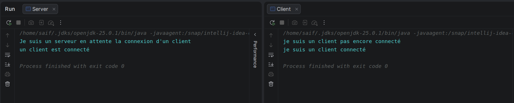
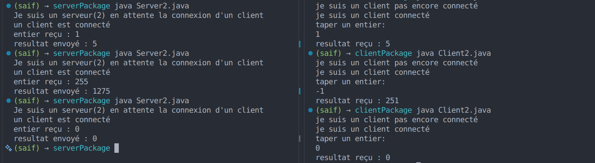
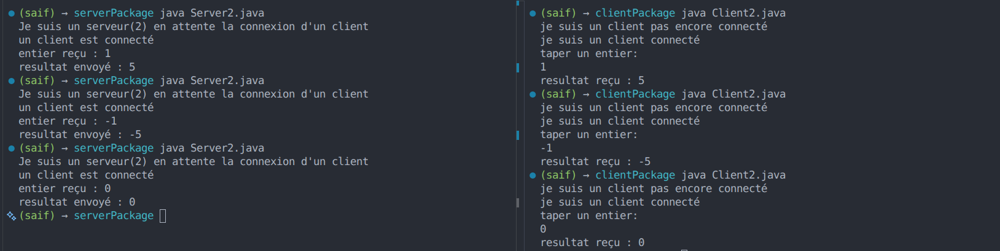
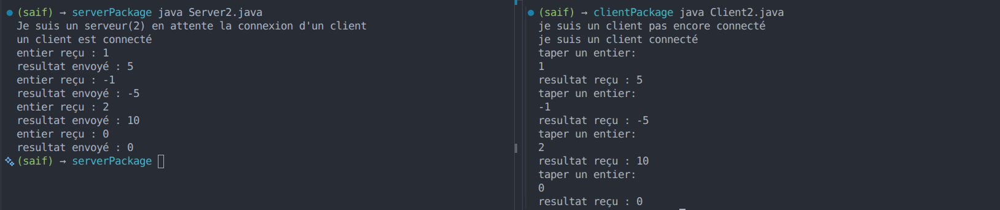
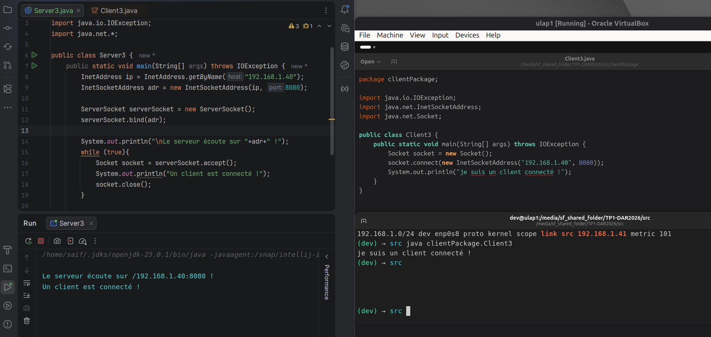

# TP1
## Activité 1

### Activité 1-1

### Activité 1-2
#### 3. Testez le programme avec différentes valeurs de x (positives, négatives, zéro):

Le client reçoit 251 au lieu de -5 parce que la communication ne peut transporter qu'un petit nombre (entre 0 et 255), donc -1 est transformé en 255 avant d'arriver au serveur. Le résultat 1275 est trop grand pour passer aussi, alors il est coupé et devient 251 ; il faut donc utiliser une méthode qui envoie l'entier en entier (`writeInt`/`readInt`).

#### 4. Exploiter les deux classes DataInputStream et DataOutputStream:

#### 5. Échange de plusieurs entiers successivement:

### Activité 1-3
#### 1. Connexion Client/Serveur sur deux machines distinctes

